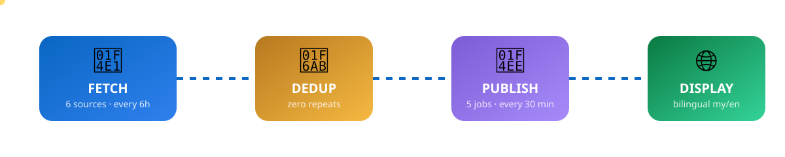
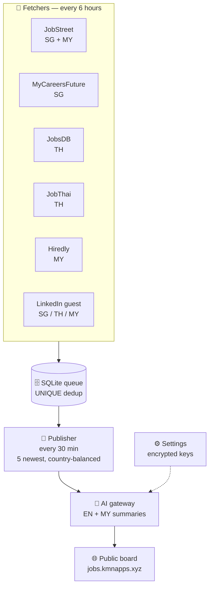

<div align="center">




<br/>

<a href="https://jobs.kmnapps.xyz"></a>


</div>

---

## ✨ What is this?

**Career Connect Network** is a fully automated, bilingual (English + မြန်မာ) job board for engineering jobs across **Singapore 🇸🇬, Thailand 🇹🇭 and Malaysia 🇲🇾**.

No human touches it. A scheduler living on the server:

1. 📡 **fetches** fresh jobs from 6 sources every 6 hours — no signup, no API keys
2. 🚫 **dedups** ruthlessly — a job can *never* appear twice
3. 📮 **publishes** the 5 newest jobs every 30 minutes with AI-written bilingual summaries
4. 🌐 **serves** them on a premium glassmorphism + neumorphism UI with light/dark mode

---

## 🎬 See it in action

<div align="center">
<a href="https://jobs.kmnapps.xyz"><b>👉 https://jobs.kmnapps.xyz</b></a>
</div>



---

## 🧩 Features

| | Feature | Details |
|---|---|---|
| 📡 | **6 keyless job sources** | JobStreet (SG/MY) · MyCareersFuture (SG) · JobsDB (TH) · JobThai (TH) · Hiredly (MY) · LinkedIn guest search (SG/TH/MY) |
| 🗂️ | **8 categories** | MEP · Electronic · AutoCAD/Revit · Telecom · Data Analysis · Python · PCB/Circuit · Mobile Tech |
| 🚫 | **Zero duplicates** | `UNIQUE(source, source_id)` + `UNIQUE(apply_url)` + permanent posted flag |
| ⚖️ | **Country-balanced posts** | every post mixes SG / TH / MY when available |
| 🤖 | **AI bilingual summaries** | one-line English + မြန်မာ summaries per job (template fallback if no key) |
| 🌓 | **Light / Dark mode** | persisted, respects OS preference, no flash |
| 🔮 | **Glass + Neu UI** | frosted-glass navbar / search / sidebar, neumorphic buttons & avatars, animated SVG hero |
| 📄 | **Pagination** | 3 posts per page, numbered pages with ellipsis |
| 🔍 | **Filters & search** | sidebar radios (country / category / source) + keyword search |
| ⏰ | **Freshness guard** | jobs older than 60 days are rejected automatically |

---

## 🏗️ Architecture



---

## 🚀 Quick start

```bash
# 1. install
npm install

# 2. run
node server.js          # → http://localhost:3000

# 3. (optional) open /settings.html and paste your AI gateway key
#    → posts get beautiful bilingual summaries instead of templates
```

> The fetch + publish schedulers start automatically with the server.
> Manual triggers live in **Settings → Test** (`POST /api/admin/fetch`, `POST /api/admin/publish`).

---

## 📁 Project structure

```
job-board/
├── server.js            # Express app + node-cron schedules
├── src/
│   ├── store.js         # SQLite layer (queue, dedup, posts, pagination)
│   ├── publisher.js     # 30-min publish cycle (5 newest, country-balanced)
│   ├── gateway.js       # AI gateway client (AES-256-GCM encrypted key)
│   └── fetchers/        # 6 keyless source scrapers
│       ├── seek.js      # JobStreet SG/MY + JobsDB TH (SEEK API)
│       ├── mcf.js       # MyCareersFuture SG
│       ├── jobthai.js   # JobThai TH
│       ├── hiredly.js   # Hiredly MY
│       └── linkedin.js  # LinkedIn guest search SG/TH/MY
├── public/
│   ├── index.html       # the board (filters, search, pagination, themes)
│   ├── settings.html    # keys + manual triggers
│   └── style.css        # premium light/dark theme (glass + neumorphism)
└── assets/              # animated README artwork ✨
```

---

## 🌐 Deployment

Runs 24/7 on a self-hosted VPS behind **PM2** (`job-board` process) + **nginx** reverse proxy with Let's Encrypt SSL:

```
https://jobs.kmnapps.xyz  →  127.0.0.1:3014  (PM2: job-board)
```

---

## 📄 License

MIT — do whatever you want, just keep the notice. 💼

<div align="center">


**#CareerConnectNetwork #Jobs #SingaporeJobs #ThailandJobs #MalaysiaJobs**

</div>
